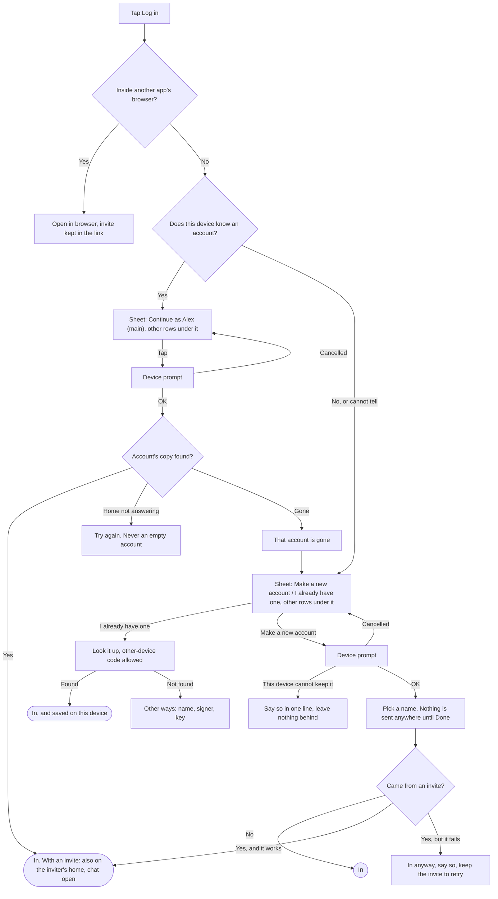
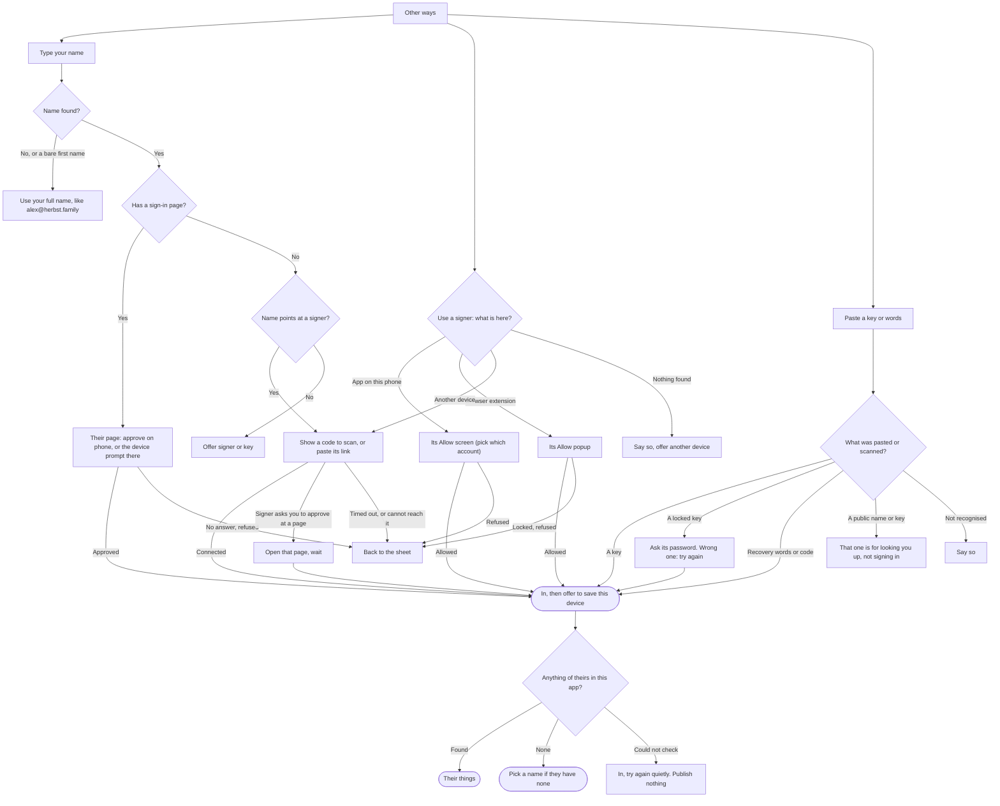

# Sign-in: the goal

Status: discussion, 2026-11-25. Nothing here is built. This is the goal the shared sign-in is refined
against, and the brief any reviewer gets before they look at it.

One sign-in flow for every project (DMs on Android and the web, Tube, Marble Web, Discover). The flow and
one set of test rows are shared. Code is per platform. The web code that exists today is `signin/` in this
repo (name-first sign-in, see its README).

## What it is for

- A new person gets in with one button and their device's own prompt. No sign-up form.
- A returning person gets back in the same way, and never ends up with a second account by accident.
- An invited person lands with whoever invited them.
- Someone who already has an account elsewhere (a signer app, a browser extension, a key) finds their
  way in without the screens leading with it.
- It can be shown to work: every way in, and every way it can fail, is a row in one smoke test.

## Decisions so far

- OPEN, leaning one button: the front page has one button, **Log in**, for new and returning people.
  Two buttons (Create account / Sign in) would only pre-pick the fork below, so nothing else here depends
  on the answer. Also open: whether to ever offer "Sign in with Google" and the like. Apple's store rule
  for apps that offer such logins, and whether a device prompt alone avoids it, needs checking before any
  iPhone app.
- Tapping Log in opens a sheet. The device's own prompt does not appear until the person taps a row.
- The main row reflects what the device knows:
  - it knows an account: **Continue as Alex**
  - it does not, or cannot tell: **Make a new account** and **I already have one**
- The main row only ever looks an account up. A new account is only made by tapping "Make a new account",
  and nothing is sent anywhere until "Pick a name" is done.
- Everything else sits behind **Other ways**: type your name, use a signer, paste a key, and a small
  "How does this work?" link.
- Nothing is sold on these screens. No "Nostr", "Keykin", "relay", "npub", "nsec", "passkey". The word
  "signer" is allowed behind Other ways (not a product name such as Amber).
- Use the device's own word for its prompt (fingerprint, face, PIN), not always "fingerprint".
- Two kinds of account, never chosen by the person:
  - an account kept by the device's own passkey sync, one per app
  - an account kept on a box someone in the family runs
  An invite from someone with a box puts you on their box. A box is only mentioned on "How does this work?".
- A box account's prompt belongs to the box's own page (for Aaron, account.syb.lol, found by typing his
  name). Apps send you there by name. So there is no shared passkey domain across apps.
- Without a box, an account made in one app and an account made in another are separate accounts.
  A box can take them in later (see Adopting).
- Not every way in is offered by every app. The table below says which.

## The filter for any proposed step

Reviewers find risks, and every risk has a fix that adds a step. A step is kept only if it passes all of
these. Every proposed change also states its cost in taps and seconds next to what it prevents.

1. It stops a loss this person would really suffer at our size, not a theoretical one.
2. A returning person on their usual device never sees it.
3. It adds no choice, screen or new word before the person's first success.
4. It is not shown so often that people stop reading it.
5. It does not ask the person to keep a secret they will rarely use.
6. It is not something the current standard (NIST SP 800-63B-4) has dropped as a burden.
7. Taking it can never lose the account or make a second one.

## Targets the smoke test measures

- Zero accidental second accounts, in every run.
- Invite link to first message in four taps or fewer, landing in the chat with the inviter.
- New person signed in within 15 seconds. Returning person within 5.
- No protocol words before the first message.
- Getting back in on a new phone without typing anything.
- No "use another device" screen on a device that already has the account.
- Still usable where the device prompt cannot unlock the account (Firefox, some passkey apps).
- At most one interruption per session after sign-up.

## The main row

"Inside another app's browser?" is a silent check, not a screen. An invite link tapped inside Messenger or
Instagram opens in that app's mini browser, where device prompts and downloads often fail. Only those
people see the "open in your browser" note.

## Other ways

After sign-in, a signer that stops answering (phone asleep) shows "Waiting for your signer" with a way to
switch. It is not an error.

## Which ways each kind of app offers (draft, untested)

| | Device prompt | Type your name | Signer app on the phone | Browser extension | Signer on another device | Paste a key |
|---|---|---|---|---|---|---|
| Android app | Yes | Yes | Yes | Not possible | Yes | Yes |
| Website on a computer | Yes | Yes | Not possible | Yes | Yes | Yes |
| Website on a phone, signs now and then (Tube) | Yes | Yes | Yes, Android only | Rare | Yes | Yes |
| Website on a phone, signs constantly (DMs) | Yes | Yes | No, a round trip per signature | Rare | Yes | Yes |

Each project runs only the smoke rows for its own line.

## Every way someone could sign in, or want to

1. Device prompt, account already on this device.
2. Device prompt, new account made now.
3. Device prompt through the device's "use another device" code. A known weak spot; avoid showing it unasked.
4. A passkey kept in a third-party passkey app. Some cannot unlock an account (Bitwarden confirmed);
   DMs already refuses those by name.
5. Account on a box, found by typed name (the login-page pointer, kind 10046), approved on a phone or by
   the device prompt on the box's page.
6. Signer app on the same Android phone (NIP-55).
7. Browser extension (NIP-07), including Safari extensions on an iPhone. Hardware signers mostly arrive
   this way.
8. Signer on another device, started here: show a code, the signer scans it (NIP-46).
9. Signer on another device, started there: paste its link (NIP-46). Hosted signers that log you in by
   email arrive this way and may send an "approve at this page" link.
10. Signer found by name (the `nip46` entry of a name's `nostr.json`).
11. Paste or scan a secret key.
12. Paste or scan a password-locked key (NIP-49).
13. Recovery words (NIP-06, account 0).
14. DMs' own recovery code and backup file.
15. Move the account from another phone by scanning a code (QRST, and DMs "Scan from your other phone").
16. Look-only with a public key. Turned away with one line.

On an iPhone there is no shared signer-app link: it is 7, 8 or 9.

## Adopting an account onto a box

Checked against the code on 2026-11-25:

- A DMs device-prompt account's key is random and locked with something only the prompt produces
  (WebAuthn PRF, relying party dms.aaro.cc). The locked copy is on the person's home. Right after the
  prompt the device holds the real key, so it can be wrapped for a box and sent. No such code exists yet.
- Keykin already takes an existing key onto a box (SPEC, import). Adopting is that path started from a
  device prompt.
- An adopted account is held by the box next to the master. It is not a true child: child keys are worked
  out from the master (see BIGGER-PICTURE.md, DIRECTION.md "Proposed, not agreed").
- Marble cannot make a device-prompt account today. Only DMs can.

Sketch: in the app, "Move this account to my box" -> type your name -> approve on the box -> device prompt
unlocks the key, it is wrapped for the box and sent -> the box signs once as the account to prove it, and
the account gets a pointer to the box's page. The old prompt keeps working.

Nothing is copied between accounts. An app that wants a combined view (all your bookmarks) reads across the
accounts your box holds.

Open: what adopting is worth to the person beyond getting back in and managing devices; that the box
owner can then act as that account, so it is a deliberate choice with a way back out.

## The box: who it is for and how it spreads

Agreed in discussion, 2026-11-25.

- The person signing in is sold nothing. The box is pitched to one person per circle (family, friends,
  later perhaps a community), and what is pitched is a role: "Give your people names that sign them in
  anywhere, and be the one who can let them back in."
- What a member holds is a name (alex@herbst.family). The box answers the two gaps of the no-box tier:
  - lost everything: someone can let you back in
  - a device that cannot tell who you are: your name works everywhere
- No-box tier, lost every device: the phone's own sync brings the account back on a new phone signed in to
  the same Google or Apple account. If that is lost too, the account is gone. Accepted, with no warning
  up front.
- Nobody goes looking for a box. You join through whoever invited you, and their home has one or not.
- Where the pitch lives: the "How does this work?" page; the dead end when someone without a box cannot
  get back in; wherever server people are talked to. Never on the sign-in screens.
- Trust thins as the circle widens, because whoever can let you back in can act as you. Two rules keep the
  choice small and reversible:
  - leaving is cheap: moving to another box, or back to just your phone, is one action
  - a box that stops existing does not take people with it: each phone keeps a working way in
- The community case (no obvious single person to hold that power) is not designed until a real one asks.

## Smoke rows

fp-new, fp-return-local, fp-return-synced, fp-none-no-dup, fp-cancel, fp-no-prf, fp-copy-gone,
fp-home-down-new-device, fp-other-device-qr, fp-wrong-app, inapp-browser, invite-new, invite-existing,
invite-dead, name-approve, name-bare-firstname, name-nip46-fallback, name-refused, signer-android-multi,
signer-ext, signer-ext-locked, signer-qr, bunker-paste, bunker-approve-page, signer-timeout,
signer-quiet-after-in, key-nsec, key-hex, ncryptsec-right, ncryptsec-wrong, words-12, words-24,
npub-turned-away, garbage, relays-down-existing, qrst-transfer, signout-signin.

First to write: fp-none-no-dup (returning person, nothing saved on this device, no second account).

## Not worked out yet

- Losing every device (device-only account and box account differ).
- Signing out. A second account on one device.
- The web cannot always tell whether an account is saved on the device before prompting.
- iPhones: nothing recorded in any project. Safari may have gained the unlock step in late 2025 (unverified).

## Evidence this leans on

- Microsoft 2024: device-prompt sign-in 98% success against 32% for passwords; "sign in faster" beat
  "more securely"; about 99% of set-ups came from a prompt at sign-up or sign-in, under 1% from settings.
  https://microsoft.com/en-us/security/blog/2024/12/12/convincing-a-billion-users-to-love-passkeys-ux-design-insights-from-microsoft-to-boost-adoption-and-security
- FIDO Alliance UX guidelines: one entry point for sign-in and account creation (user testing).
  https://fidoalliance.org/fido-alliance-publishes-research-backed-guidelines-for-optimizing-user-sign-in-experience-with-passkeys/
- KAYAK: one sheet, and the device is told which accounts exist so a second cannot be made.
  https://developers.googleblog.com/en/how-kayak-reduced-sign-in-time-by-50-and-improved-security-with-passkeys/
- Akhawe and Felt 2013: frequent warnings are clicked through.
  https://www.usenix.org/conference/usenixsecurity13/technical-sessions/paper/akhawe
- Bailey, Markert, Aviv, SOUPS 2021: 44% of Signal users could not say what their PIN is for.
  https://usenix.org/system/files/soups2021-bailey.pdf
- NIST SP 800-63B-4 (2025): removes burdens, accepts synced passkeys.
  https://pages.nist.gov/800-63-4/sp800-63b/authenticators/

No real evidence found for: one button against two (conversion), people lost per added step, invite links
that land in the right place after install, or sign-in usability on Nostr. For those, the smoke test and
the next real invites are the evidence.

## Aaron's answers to the first review pass (2026-11-25)

Answers to the seven decisions at the end of SIGN-IN-REVIEW-1.md. Where these differ from text above,
these win; the sections above still need rewriting to match.

1. Agreed: every account starts the same way, as a device-prompt account, and a box takes it in afterwards.
2. Narrowed on 2026-11-25 (evening): a box resets you with a code, and the reset always shows. It never
   acts as you. Day to day it holds one piece, as Keykin is built. See "Approved picks" below.
3. No default home on Aaron's server. He does not want to be the admin for everyone. Proposed instead, not
   yet agreed and not yet checked against the fingerprint design notes:
   - DMs makes no account without an invite. With no invite the front page offers "I already have an
     account" and a line about opening the invite link.
   - In the open apps (Tube, Marble) the account's key is worked out directly from what the device prompt
     produces, so there is no locked copy to keep anywhere. The device's own sync carries it to the next
     phone. Cost: the account is tied to that one saved prompt for good.
4. Agreed: two entries, "Make a new account" and "I already have an account", ordered by whether there is
   an invite, collapsing to "Continue as Alex" when the device knows them. This replaces the single
   "Log in" button.
5. The detected row reads "Continue with Signer", never the app's own name. No exception to the
   product-name rule.
6. Agreed: invites open the web version first; the Android app is offered after the first message.
7. Recovery words are out of the new flow: no row, no smoke test (drop words-12 and words-24), and the
   paste box says it does not take them. He had already ruled that this kind of recovery usually fails.
   DMs' existing 24-word recovery code is a separate question and is not part of onboarding.

## Approved picks (2026-11-25, evening)

Relayed from another session as Aaron's words: "go with your picks, tell the sign-in session". Recorded
here as relayed; he checks them in the morning. Where these differ from text above, these win.

1. **Audience: his apps only for now.** No neutral public repo. The sign-in stays with Keykin.
2. **Box: it resets you with a code, and the reset always shows. It never acts as you.** The owner
   approves and passes a code; the member taps it on the new phone and uses that phone's prompt; the
   member's other devices and the owner's log show it happened.
3. **People with no invite: a stored account whose locked copy is kept on ordinary relays**, signed by the
   account itself. No derived fallback, because losing the passkey would lose the account. DMs still makes
   no account without an invite, so this is for the open apps (Tube, Marble) only.
   **Agreed (Aaron, 2026-11-26):** "seems insane to think a count of accounts is actually a risk vector
   compared to all eggs being stuck in one basket." Then: "countable forever *might* be a risk in some
   form. but it's a lower risk than all eggs in one basket." So a copy that can be listed and counted is a
   real but smaller risk; the relay copy wins because losing the only copy is the bigger one. Not built yet.
4. **Do not start again from ~/archive/signin. Move its good parts into keykin/signin**, on a branch, with
   tests: extension sign-in first (review C1), signers that ask for approval on a web page (C2), and its
   local test stand-ins (relay, stand-in phone app, fake extension). Copying into the apps comes after he
   has looked at the branch.
5. **Keep the passkey format and "where the copy is kept" behind one small interface.** Follow
   nips PR 2519's format if it settles; do not wait for it.

## Browser extension sign-in (Aaron, 2026-11-26)

- **Allowed everywhere.** Cutting extension users off was not intended. Many people use only an extension,
  and he was one of them. No site signs anyone out for having used one. (The removal came in with Marble
  Web's 2026-11-18 change, 2a2a0bf, and was carried into the shared copy.)
- **For now it keeps its place as the easiest option:** when an extension is found, its row is first.
- **Long-term goal, parked, not to be built yet:** he sees extensions as not the future and eventually
  going away. Once Keykin is fleshed out, the extension moves to last in order, shown after the better way
  has been put in front of the person. That pitch is reserved: small, plain, not made to look like selling.
  Parked because Keykin is not ready to be what gets shown first.
